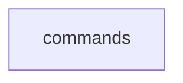

_Generated by CodeAtlas._

## Details

Owns 1 symbols across 2 file(s).

### commands

Owns 6 symbols across 7 file(s).

**Related Classes/Methods:** _None_

**Source Files:**

- `pyagenthound/cli/commands/analyze.py`
  - `pyagenthound.cli.commands.analyze.analyze_command`
- `pyagenthound/cli/commands/init.py`
  - `pyagenthound.cli.commands.init.init_command`
- `pyagenthound/cli/commands/inspect.py`
  - `pyagenthound.cli.commands.inspect.inspect_command`
- `pyagenthound/cli/commands/replay.py`
  - `pyagenthound.cli.commands.replay.replay_command`
- `pyagenthound/cli/commands/serve.py`
  - `pyagenthound.cli.commands.serve.serve_command`
- `pyagenthound/cli/commands/test.py`
  - `pyagenthound.cli.commands.test.test_command`
