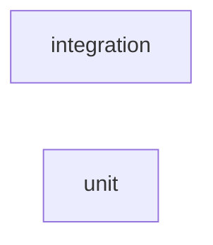

_Generated by CodeAtlas._

## Details

Owns 5 symbols across 2 file(s).

### integration

Owns 60 symbols across 5 file(s).

**Related Classes/Methods:** _None_

**Source Files:**

- `tests/integration/test_api_traces.py`
  - `tests.integration.test_api_traces._FakeProvider`
  - `tests.integration.test_api_traces._FakeProvider.__init__`
  - `tests.integration.test_api_traces._FakeProvider.complete`
  - `tests.integration.test_api_traces._client`
  - `tests.integration.test_api_traces._post_trace`
  - `tests.integration.test_api_traces.test_analyze_includes_baseline_findings_when_available`
  - `tests.integration.test_api_traces.test_analyze_trace_404`
  - `tests.integration.test_api_traces.test_analyze_trace_returns_findings`
  - `tests.integration.test_api_traces.test_create_list_get_trace`
  - `tests.integration.test_api_traces.test_explain_404`
  - `tests.integration.test_api_traces.test_explain_no_findings_returns_400`
  - `tests.integration.test_api_traces.test_explain_returns_grounded_explanation`
  - `tests.integration.test_api_traces.test_explain_unavailable_provider_returns_503`
  - `tests.integration.test_api_traces.test_explain_unavailable_provider_returns_503._UnavailableProvider`
  - `tests.integration.test_api_traces.test_explain_unavailable_provider_returns_503._UnavailableProvider.complete`
  - `tests.integration.test_api_traces.test_get_trace_404`
  - `tests.integration.test_api_traces.test_get_trace_graph`
  - `tests.integration.test_api_traces.test_get_trace_graph_404`
  - `tests.integration.test_api_traces.test_health`
  - `tests.integration.test_api_traces.test_list_traces_name_filter`
  - `tests.integration.test_api_traces.test_list_traces_status_filter`
  - `tests.integration.test_api_traces.test_replay_404`
  - `tests.integration.test_api_traces.test_replay_requires_confirmation_for_unsafe_override`
  - `tests.integration.test_api_traces.test_replay_resolves_finding`
  - `tests.integration.test_api_traces.test_root_cause_404`
  - `tests.integration.test_api_traces.test_root_cause_returns_ranked_hypotheses`
  - `tests.integration.test_api_traces.test_root_cause_sets_temporal_correlation_from_baseline`
- `tests/integration/test_cli.py`
  - `tests.integration.test_cli.test_analyze_explain_flag_prints_grounded_narrative`
  - `tests.integration.test_cli.test_analyze_explain_flag_prints_grounded_narrative._FakeProvider`
  - `tests.integration.test_cli.test_analyze_explain_flag_prints_grounded_narrative._FakeProvider.__init__`
  - `tests.integration.test_cli.test_analyze_explain_flag_prints_grounded_narrative._FakeProvider.complete`
  - `tests.integration.test_cli.test_analyze_explain_flag_shows_unavailable_message`
  - `tests.integration.test_cli.test_analyze_explain_flag_shows_unavailable_message._UnavailableProvider`
  - `tests.integration.test_cli.test_analyze_explain_flag_shows_unavailable_message._UnavailableProvider.__init__`
  - `tests.integration.test_cli.test_analyze_explain_flag_shows_unavailable_message._UnavailableProvider.complete`
  - `tests.integration.test_cli.test_analyze_missing_trace_errors`
  - `tests.integration.test_cli.test_analyze_no_findings`
  - `tests.integration.test_cli.test_analyze_prints_findings`
  - `tests.integration.test_cli.test_analyze_shows_baseline_comparison`
  - `tests.integration.test_cli.test_init_creates_db`
  - `tests.integration.test_cli.test_inspect_missing_trace_errors`
  - `tests.integration.test_cli.test_inspect_prints_trace`
  - `tests.integration.test_cli.test_replay_missing_trace_errors`
  - `tests.integration.test_cli.test_replay_requires_confirmation_for_unsafe_override`
  - `tests.integration.test_cli.test_replay_resolves_finding`
  - `tests.integration.test_cli.test_serve_refuses_non_loopback_without_allow_external`
  - `tests.integration.test_cli.test_test_command_errors_on_missing_trace`
  - `tests.integration.test_cli.test_test_command_fails_on_failed_assertion`
  - `tests.integration.test_cli.test_test_command_no_test_cases`
  - `tests.integration.test_cli.test_test_command_passes`
- `tests/integration/test_llm_real_ollama.py`
  - `tests.integration.test_llm_real_ollama._ollama_available`
  - `tests.integration.test_llm_real_ollama.test_explain_root_cause_against_real_ollama`
- `tests/integration/test_ui.py`
  - `tests.integration.test_ui._client`
  - `tests.integration.test_ui.test_replay_from_ui_redirects_to_replayed_trace`
  - `tests.integration.test_ui.test_replay_from_ui_unsafe_override_redirects_with_error`
  - `tests.integration.test_ui.test_request_detail_404`
  - `tests.integration.test_ui.test_request_detail_renders_findings_and_root_cause`
  - `tests.integration.test_ui.test_requests_list_empty_state`
  - `tests.integration.test_ui.test_requests_list_name_filter`
  - `tests.integration.test_ui.test_requests_list_shows_traces`

### unit

Owns 93 symbols across 12 file(s).

**Related Classes/Methods:** _None_

**Source Files:**

- `tests/unit/test_baseline.py`
  - `tests.unit.test_baseline._at`
  - `tests.unit.test_baseline.test_compare_to_baseline_detects_execution_path_change`
  - `tests.unit.test_baseline.test_compare_to_baseline_detects_latency_regression`
  - `tests.unit.test_baseline.test_compare_to_baseline_detects_model_change`
  - `tests.unit.test_baseline.test_compare_to_baseline_detects_token_growth`
  - `tests.unit.test_baseline.test_compare_to_baseline_no_findings_when_nothing_changed`
  - `tests.unit.test_baseline.test_extract_signature_aggregates_llm_retrieval_and_tools`
  - `tests.unit.test_baseline.test_extract_signature_total_tokens_none_when_no_llm_spans`
  - `tests.unit.test_baseline.test_find_baseline_ignores_successful_traces_started_after_current`
  - `tests.unit.test_baseline.test_find_baseline_returns_most_recent_successful_same_name`
  - `tests.unit.test_baseline.test_find_baseline_returns_none_when_no_prior_success`
  - `tests.unit.test_baseline.test_historical_rule_frequencies_computes_fraction`
  - `tests.unit.test_baseline.test_historical_rule_frequencies_empty_when_no_history`
- `tests/unit/test_evaluation.py`
  - `tests.unit.test_evaluation._trace_with_tool_and_output`
  - `tests.unit.test_evaluation.test_load_test_cases_loads_all_json_files`
  - `tests.unit.test_evaluation.test_no_finding_assertion_uses_real_rule_engine`
  - `tests.unit.test_evaluation.test_no_tool_called_assertion`
  - `tests.unit.test_evaluation.test_output_contains_assertion`
  - `tests.unit.test_evaluation.test_save_and_load_test_case_roundtrip`
  - `tests.unit.test_evaluation.test_span_exists_assertion`
  - `tests.unit.test_evaluation.test_status_ok_assertion_passes_and_fails`
  - `tests.unit.test_evaluation.test_test_case_result_fails_if_any_assertion_fails`
- `tests/unit/test_graph.py`
  - `tests.unit.test_graph._sample_trace`
  - `tests.unit.test_graph.test_ancestors_walks_back_through_retrieval_and_parent_edges`
  - `tests.unit.test_graph.test_build_graph_creates_root_and_span_nodes`
  - `tests.unit.test_graph.test_build_graph_parent_edges_form_tree`
  - `tests.unit.test_graph.test_dangling_parent_attaches_to_trace_root`
  - `tests.unit.test_graph.test_neighbors_includes_both_directions`
  - `tests.unit.test_graph.test_non_retrieval_span_produces_no_extra_nodes`
  - `tests.unit.test_graph.test_retrieval_extractor_creates_document_nodes_and_edges`
- `tests/unit/test_llm_explain.py`
  - `tests.unit.test_llm_explain._FakeProvider`
  - `tests.unit.test_llm_explain._FakeProvider.__init__`
  - `tests.unit.test_llm_explain._FakeProvider.complete`
  - `tests.unit.test_llm_explain._findings_and_hypotheses`
  - `tests.unit.test_llm_explain.test_explain_root_cause_rejects_invalid_json`
  - `tests.unit.test_llm_explain.test_explain_root_cause_rejects_missing_fields`
  - `tests.unit.test_llm_explain.test_explain_root_cause_rejects_non_string_citations`
  - `tests.unit.test_llm_explain.test_explain_root_cause_rejects_unsupported_citation`
  - `tests.unit.test_llm_explain.test_explain_root_cause_requires_findings`
  - `tests.unit.test_llm_explain.test_explain_root_cause_returns_grounded_explanation`
- `tests/unit/test_llm_providers.py`
  - `tests.unit.test_llm_providers.test_ollama_provider_raises_when_unreachable`
- `tests/unit/test_models.py`
  - `tests.unit.test_models.test_span_duration_ms`
  - `tests.unit.test_models.test_span_duration_ms_none_when_not_ended`
  - `tests.unit.test_models.test_span_type_defaults_to_custom`
  - `tests.unit.test_models.test_trace_json_roundtrip`
- `tests/unit/test_replay.py`
  - `tests.unit.test_replay.test_apply_overrides_clones_with_new_ids_and_applies_attributes`
  - `tests.unit.test_replay.test_build_plan_marks_unsafe_overridden_steps`
  - `tests.unit.test_replay.test_build_plan_read_only_override_does_not_require_confirmation`
  - `tests.unit.test_replay.test_classify_span_safety_defaults`
  - `tests.unit.test_replay.test_classify_span_safety_honors_explicit_attribute`
  - `tests.unit.test_replay.test_classify_span_safety_ignores_invalid_declared_value`
  - `tests.unit.test_replay.test_run_replay_requires_confirmation_for_unsafe_override`
  - `tests.unit.test_replay.test_run_replay_resolves_finding`
- `tests/unit/test_rootcause.py`
  - `tests.unit.test_rootcause._at`
  - `tests.unit.test_rootcause.test_causal_proximity_decreases_with_distance`
  - `tests.unit.test_rootcause.test_causal_proximity_off_path_uses_fixed_fallback`
  - `tests.unit.test_rootcause.test_combine_confidence_all_four_components`
  - `tests.unit.test_rootcause.test_combine_confidence_two_components_renormalizes`
  - `tests.unit.test_rootcause.test_hops_to_ancestor_direct_parent`
  - `tests.unit.test_rootcause.test_hops_to_ancestor_returns_none_for_sibling`
  - `tests.unit.test_rootcause.test_rank_root_causes_empty_when_no_findings`
  - `tests.unit.test_rootcause.test_rank_root_causes_orders_by_confidence_descending`
  - `tests.unit.test_rootcause.test_rank_root_causes_single_finding_is_likely_cause`
  - `tests.unit.test_rootcause.test_rank_root_causes_with_store_merges_baseline_and_sets_temporal_correlation`
  - `tests.unit.test_rootcause.test_rank_root_causes_without_store_leaves_temporal_and_historical_none`
- `tests/unit/test_rules.py`
  - `tests.unit.test_rules._graph_for`
  - `tests.unit.test_rules.test_dangling_parent_span_rule_flags_missing_parent`
  - `tests.unit.test_rules.test_dangling_parent_span_rule_ignores_resolved_parent`
  - `tests.unit.test_rules.test_duplicate_retrieved_documents_rule_flags_repeats`
  - `tests.unit.test_rules.test_duplicate_retrieved_documents_rule_ignores_unique_documents`
  - `tests.unit.test_rules.test_empty_retrieval_rule_flags_zero_documents`
  - `tests.unit.test_rules.test_empty_retrieval_rule_ignores_nonempty_results`
  - `tests.unit.test_rules.test_finding_id_is_deterministic_across_repeated_runs`
  - `tests.unit.test_rules.test_run_rules_aggregates_across_builtin_rules`
  - `tests.unit.test_rules.test_stale_retrieval_documents_rule_flags_older_documents`
  - `tests.unit.test_rules.test_stale_retrieval_documents_rule_ignores_same_dated_documents`
  - `tests.unit.test_rules.test_stale_retrieval_documents_rule_needs_at_least_two_dated_docs`
  - `tests.unit.test_rules.test_tool_failure_rule_flags_error_status`
  - `tests.unit.test_rules.test_tool_failure_rule_ignores_successful_calls`
- `tests/unit/test_sdk_client.py`
  - `tests.unit.test_sdk_client.test_manual_trace_and_span`
  - `tests.unit.test_sdk_client.test_nested_spans_set_parent`
  - `tests.unit.test_sdk_client.test_span_decorator_requires_active_trace`
  - `tests.unit.test_sdk_client.test_span_decorator_requires_active_trace.f`
  - `tests.unit.test_sdk_client.test_span_records_error`
  - `tests.unit.test_sdk_client.test_trace_and_span_decorators`
  - `tests.unit.test_sdk_client.test_trace_and_span_decorators.inner`
  - `tests.unit.test_sdk_client.test_trace_and_span_decorators.outer`
  - `tests.unit.test_sdk_client.test_trace_status_reflects_a_span_error_even_when_the_caller_catches_it`
- `tests/unit/test_sqlite_store.py`
  - `tests.unit.test_sqlite_store.test_get_trace_missing_returns_none`
  - `tests.unit.test_sqlite_store.test_list_traces_name_filter`
  - `tests.unit.test_sqlite_store.test_list_traces_pagination_and_status_filter`
  - `tests.unit.test_sqlite_store.test_save_and_get_trace_roundtrip`
  - `tests.unit.test_sqlite_store.test_save_trace_upsert_updates_existing`
