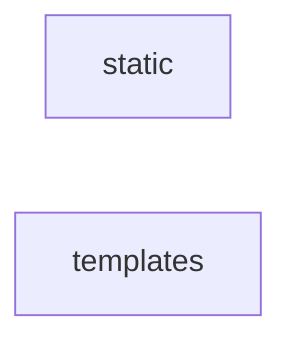

_Generated by CodeAtlas._

## Details

Owns 4 symbols across 2 file(s).

### static

Owns 4 symbols across 2 file(s).

**Related Classes/Methods:** _None_

**Source Files:**

- `pyagenthound/ui/static/graph.js`
  - `pyagenthound.ui.static.graph.el`
  - `pyagenthound.ui.static.graph.layout`
  - `pyagenthound.ui.static.graph.render`
  - `pyagenthound.ui.static.graph.showDetail`

### templates

Owns 0 symbols across 3 file(s).

**Related Classes/Methods:** _None_
